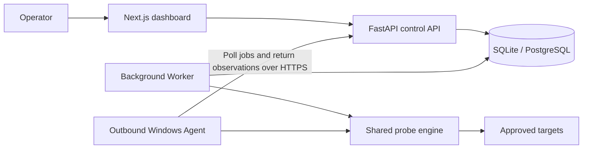

# NetGuardian — Network Diagnostics & Evidence-Based Troubleshooting Platform

Explore the fictional hotel dashboard at `/demo` after starting the web app. It
requires no workspace token and uses only simulated observations. See
[Hospitality IT Operations](docs/product/HOSPITALITY_OPERATIONS.md).

**English** · [简体中文](README.zh-CN.md)

NetGuardian helps IT teams investigate why a service is unreachable by checking
each layer of the connection and keeping a record of what each check found.

[Quick start](#quick-start) · [Architecture](#system-architecture) · [Demo evidence](#demo-evidence) · [Verification](#test--verification-status)

## Why I Built This

When a workstation can reach one service but a front-desk device cannot,
the support ticket rarely tells you whether the failure is in name resolution,
connectivity, TLS, or the application. I built NetGuardian to make that investigation
repeatable and to give the next technician the observations behind a finding.

NetGuardian grew from a Python and Streamlit toolkit into an independent portfolio
project informed by my work troubleshooting LAN/WLAN, TCP/IP, DNS, DHCP and
Windows endpoint connectivity. The scenarios here use controlled test systems.

## Key Features

| Capability | What it shows |
| --- | --- |
| Layered diagnostics | DNS records, TCP connectivity, TLS handshake and certificate details, and HTTP HEAD status and timing. Opt-in ICMP and traceroute provide additional reachability and path evidence. |
| Scheduled monitoring | Pause and resume checks, review collection freshness, and follow incident and recovery history. Missing observations are shown as gaps. |
| Two-location comparison | Pair a server-side check with one from an enrolled Windows Agent. Compare the recorded observations within the limits of their endpoints and timing. |
| Incident evidence | Open saved, redacted report snapshots, verify their SHA-256 digests, and trace findings back to the underlying observations. |
| Optional investigation | Use a configured Ollama model to summarize report evidence. Validated findings and unverified hypotheses are displayed separately. |

## System Architecture



- [Web dashboard](web/) and [FastAPI API](service/api.py) handle authenticated requests and workspace views.
- The [Worker](service/worker.py) claims leased jobs from the database and persists observations. The [Agent](agent/) polls the API over HTTPS and applies its own local target policy.
- The [probe engine](probe_core/) runs bounded checks. [Alembic migrations](migrations/) track schema changes, and [report export](service/report_files.py) checks saved snapshot integrity.

See the [system design](docs/architecture/SYSTEM_DESIGN.md) and [data model](docs/architecture/DATA_MODEL.md).

## Engineering Highlights

- **Probe safety.** Server-side probes deny targets by default and require exact approved origins. The executor connects to a validated numeric address while preserving the hostname for HTTP and TLS. HTTP uses HEAD with bounded headers and no redirect following.
- **Measurement semantics.** DNS, TCP, TLS and HTTP timing are kept separate. HTTP duration describes an application-layer request, while ICMP round-trip time measures an echo exchange.
- **Asynchronous delivery.** API acceptance is separate from execution. Jobs have leases and expiry, and the Agent has a local result spool to retry delivery without repeating a completed probe.
- **Reproducible evidence.** Reports retain the observations used to explain an incident. The export preserves the stored snapshot for [offline checksum verification](scripts/verify_report.py).

See [responsible probing and measurement details](docs/operations/LOCAL_DEVELOPMENT.md#target-policy-and-measurement-semantics) and the [threat model](docs/security/THREAT_MODEL.md).

## Demo Evidence

| Scenario | Evidence |
| --- | --- |
| Service returns HTTP 503, then recovers to HTTP 204 | A controlled loopback HTTPS integration exercised an Agent monitor. The local browser QA recorded both statuses, incident recovery and the checksum-verified report. [Browser QA record](docs/product/BROWSER_QA.md#populated-workflow-check-2026-11-05) |
| Operator exports a report | A local browser download was checked with the offline verifier. The test environment used isolated evidence and a test workspace. [Export QA record](docs/product/BROWSER_QA.md#real-model-investigation-and-report-export-2026-11-06) |
| An operator browses missing observations | A synthetic fixture of 101 failed jobs exercised pagination and the UI message for missing measurements. [Fixture QA record](docs/product/BROWSER_QA.md#retained-history-production-web-build-2026-11-05) |

These are local QA records. The HTTPS results came from a controlled test server, and the history fixture contains synthetic job state.

## Technology Stack

Python 3.11 · FastAPI · SQLAlchemy · Alembic · SQLite / PostgreSQL · Next.js · React · TypeScript · Node.js 24 · pnpm · pytest · Ruff · GitHub Actions

## Quick Start

**Windows local evaluation.** Install Python 3.11 and Node.js 24. From PowerShell:

```powershell
git clone https://github.com/TYF009/NetGuardian.git
Set-Location NetGuardian
python -m pip install uv==0.13.7
npm install -g pnpm@11.25.0
uv sync --locked
pnpm --dir web install --frozen-lockfile
pnpm --dir web build

$workspaceToken = (uv run --locked python -c "import secrets; print(secrets.token_urlsafe(32))").Trim()
$env:NETGUARDIAN_TOKENS = @{ $workspaceToken = 'local' } | ConvertTo-Json -Compress
$env:NETGUARDIAN_ORIGINS = '{}'
$env:NETGUARDIAN_VANTAGE_ID = [guid]::NewGuid().ToString()
$workspaceToken
uv run --locked python -m scripts.run_windows --migrate
```

Open [the local dashboard](http://127.0.0.1:3000), enter the test workspace token printed
in PowerShell. The empty origin list lets you explore the UI
without enabling probes. Use a fresh checkout or back up an existing database
before migration. Keep a stable Worker location ID when retaining observations
across sessions.

For separate API, Worker and Web processes, authorized targets, Agent enrollment
and configuration, see the [local development guide](docs/operations/LOCAL_DEVELOPMENT.md).
See the [operations runbook](docs/operations/RUNBOOK.md) for readiness, backups and
troubleshooting.

## Test & Verification Status

- **Automated checks.** GitHub Actions runs Python unit and selected runtime tests on Windows and Ubuntu, PostgreSQL integration tests, and Web tests, TypeScript checks, schema drift checks and a Next.js production build. See the [workflow](.github/workflows/ci.yml) and [main baseline run](https://github.com/TYF009/NetGuardian/actions/runs/42789779017).
- **Controlled local verification.** The [Windows delivery record](docs/product/WINDOWS_DELIVERY.md) documents loopback TLS, Agent workflows, database verification and browser checks with their scope.
- **Reproduce checks.** Run these from the repository root. The [local guide](docs/operations/LOCAL_DEVELOPMENT.md#checks-and-operations) describes optional integration prerequisites.

```sh
uv run --locked ruff check .
uv run --locked ruff format --check .
uv run --locked pytest -q
uv run --locked pytest integration -q -rs
pnpm --dir web test
pnpm --dir web typecheck
pnpm --dir web build
```

## Current Limitations

- The documented delivery target is local Windows evaluation. Docker Compose deployment and broader Linux runtime qualification remain open.
- Loopback tests cover the job and Agent flows. Cross-machine rollout, signed Agent distribution and sustained multi-replica load remain unverified.
- Ollama is optional and experimental. A bounded local scenario demonstrates the evidence checks, with broader diagnosis quality still to evaluate.

See the [delivery checklist](docs/product/DELIVERY_STATUS.md) for the current verification boundaries.

## Roadmap

- Publish a read-only demo of a controlled incident and recovery with clearly labeled data and a verifiable report.
- Verify Compose startup and migrations from a clean environment, then document the supported operating scope.
- Validate Agent enrollment, reconnect and two-location comparisons across separate test hosts.

## Author

I am a Communication Engineering graduate with Huawei HCIP Datacom certification,
experience in 400G optical transport operations, and hands-on IT infrastructure
and network support experience. NetGuardian brings that troubleshooting practice
together with Python automation and a web-based evidence workflow.

## License

The project source and documentation are available under the [MIT License](LICENSE).
See [NOTICE.md](NOTICE.md) for third-party and legacy asset scope.
