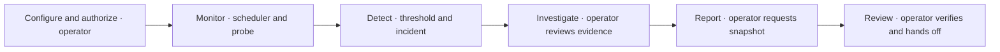
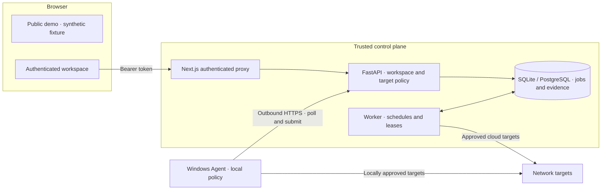

# NetGuardian — Hospitality IT Infrastructure Monitoring & Network Diagnostics Platform

[](https://github.com/TYF009/NetGuardian/actions/workflows/ci.yml) [](LICENSE)

**English** · [简体中文](README.zh-CN.md)
[Demo quick start](#demo-quick-start) · [Full local deployment](#full-local-deployment) · [Documentation](docs/README.md)

NetGuardian is an open-source network monitoring and evidence-based troubleshooting platform developed to support hotel IT operations. I designed and built it independently using FastAPI, Next.js, a background worker, SQLite/PostgreSQL and a Windows Agent.

- **Hotel operations:** Approved for use and deployed in IT operations at Hengze Hotel.
- **Portfolio demo:** A token-free walkthrough of a fictional property, served locally from the frontend.
- **Open-source implementation:** The authenticated workspace, scheduler, Agent and evidence pipeline are available under the MIT license.

## Why I Built This

Supporting hotel LAN/WLAN, Windows workstations, front desk systems and POS connectivity exposed a recurring problem: DNS, TCP, TLS and HTTP checks were spread across tools, repeated manually, and difficult to hand off with consistent evidence. I built NetGuardian to bring authorized checks, scheduled observations, incident history and evidence reports into one workflow. It grew from a Streamlit prototype into a FastAPI control plane, a Next.js workspace, a durable worker and an outbound Windows Agent.

## Hengze Hotel IT Operations

NetGuardian was approved for use and deployed in IT operations at Hengze Hotel, where I worked as an IT Infrastructure & Network Engineer. My responsibilities included LAN/WLAN support, TCP/IP, DNS and DHCP troubleshooting, Windows support, front desk and POS connectivity, and Python automation. The deployment scope, network design, operational records and outcomes remain private. The public demo is isolated and uses Aster Quay Hotel, a fictional property.

## Screenshots

All three images are real browser captures of the simulated Aster Quay Hotel demo.

| Infrastructure overview and service health | Configured logical topology and incidents |
| --- | --- |
|  |  |


[More screenshots, including the authenticated workspace and evidence report](docs/product/DEMO_GUIDE.md)

## End-to-End IT Operations Workflow



In the demo, a POS endpoint returns HTTP 503 while the probe completes and collection remains current. The operator can inspect recorded layer evidence and review possible explanations. A separate local HTTPS integration scenario exercises incident creation, HTTP 204 recovery and an evidence snapshot. In the workspace the scheduler runs checks and applies incident thresholds automatically. An operator authorizes targets, assesses probable causes, requests reports and decides what action to take. Recovery records a measured change; it does not identify a root cause.

## Core Features

| Capability | Implementation and verification |
| --- | --- |
| Network diagnostics | DNS, TCP, TLS and HTTP HEAD. ICMP and traceroute are opt-in system probes with bounded commands and explicit capability failures. HTTP duration and ICMP RTT are separate. |
| Scheduled monitoring and incidents | Durable schedules, freshness, failure and recovery thresholds, retained incident evidence and explicit gaps. Covered by worker and local integration checks. |
| Windows Agent and comparison | Enrollment and outbound HTTPS, independent local policy, and cloud-to-Agent comparison when the observations meet compatibility requirements. Verified in controlled integration. |
| Hospitality dashboard and topology | Live workspace trends use authorized API data. The interactive React Flow topology uses configured logical links in the simulated demo. |
| Evidence reports | Immutable snapshots and SHA-256 integrity verification. The digest can detect modified content; it does not authenticate the author or the observation. |
| Optional Ollama investigation | Evidence-checked recorded facts and separately labeled hypotheses. Experimental interpretation, with limited real-model validation. |
| Security | Default-deny origin policies, DNS/address validation and IP pinning, tenant-scoped data access and independent Agent policy. |

## Architecture



The API stores jobs; the worker or an enrolled Agent executes them asynchronously. Measurements share a versioned schema, and the database links incident evidence to source jobs. The authenticated workspace calls an allowlisted Next.js proxy. The demo has its own static fixture and no control API connection. [System design](docs/architecture/SYSTEM_DESIGN.md) · [Data model](docs/architecture/DATA_MODEL.md)

## Demo Quick Start

Use Node.js 24 and pnpm 11.25.0. Run these commands in PowerShell from a directory where you can create a checkout:

```powershell
git clone https://github.com/TYF009/NetGuardian.git
Set-Location NetGuardian
npm install -g pnpm@11.25.0
pnpm --dir web install --frozen-lockfile
pnpm --dir web build
pnpm --dir web start
```

Open [the local demo](http://127.0.0.1:3000/). `/demo` is an alias. The demo requires no Python, database, Agent, backend or token, and sends no real probes. [Demo walkthrough](docs/product/DEMO_GUIDE.md)

## Full Local Deployment

Use Windows, Python 3.11, uv 0.13.7, Node.js 24 and pnpm 11.25.0. Install and build the Web app as above, then stop the demo process with Ctrl+C so the full launcher can use port 3000. Run from the repository root:

```powershell
python -m pip install uv==0.13.7
uv sync --locked
$workspaceToken = (uv run --locked python -c "import secrets; print(secrets.token_urlsafe(32))").Trim()
$env:NETGUARDIAN_TOKENS = @{ $workspaceToken = 'local' } | ConvertTo-Json -Compress
$env:NETGUARDIAN_ORIGINS = '{}'
$env:NETGUARDIAN_VANTAGE_ID = [guid]::NewGuid().ToString()
$workspaceToken
uv run --locked python -m scripts.run_windows --migrate
```

Open [the authenticated workspace](http://127.0.0.1:3000/workspace) and use the generated local token. Empty origins disable target probing. Set `NETGUARDIAN_ORIGINS` to a JSON mapping of workspace IDs to approved exact origins when ready; keep the token private and reuse a stable vantage ID for retained data. Back up any existing database before migration. The launcher applies Alembic migrations and starts API, worker and Web on loopback. [Separate service commands, database settings, Agent enrollment and troubleshooting](docs/operations/LOCAL_DEVELOPMENT.md) · [Operator runbook](docs/operations/RUNBOOK.md)

## Testing & Verification

```sh
uv run --locked ruff check .
uv run --locked ruff format --check .
uv run --locked pytest -q
uv run --locked pytest integration/test_tls.py integration/test_dns_runtime.py integration/test_agent_workflow.py -q
pnpm --dir web test
pnpm --dir web typecheck
pnpm --dir web build
```

[GitHub Actions](https://github.com/TYF009/NetGuardian/actions/workflows/ci.yml) runs Windows and Ubuntu checks, PostgreSQL integration, OpenAPI drift checks and the Web build. Some integration cases require a disposable PostgreSQL database, real model or OS credential store. [Verification record](docs/product/VERIFICATION.md) · [Browser QA](docs/product/BROWSER_QA.md) · [Windows delivery and limits](docs/product/WINDOWS_DELIVERY.md)

CI and test fixtures document behavior in controlled environments. The approved hotel use is a separate operational fact. Current local delivery targets Windows; the Compose configuration does not establish a supported public or cross-machine deployment.

## Security & Privacy

Probe only targets you are authorized to monitor. The control plane enforces exact origin allowlists and scope boundaries. Cloud address validation rejects private and special addresses; an Agent independently enforces its approved origins and explicit private CIDRs where supported. Workspace bearer tokens stay in browser memory and Agent credentials use the OS credential store. Keep production topology, addresses, logs and credentials private. The public demo uses only synthetic data. [Threat model](docs/security/THREAT_MODEL.md) · [Licensing and third-party assets](NOTICE.md)

## Roadmap & Author

Next priorities are private asset and zone configuration, device telemetry, monitor-to-topology mapping, stronger evidence analysis, and broader deployment and operational validation.

**TYF009** · Communication Engineering background · HCIP Datacom · Hotel IT infrastructure and technical support · Network automation.
