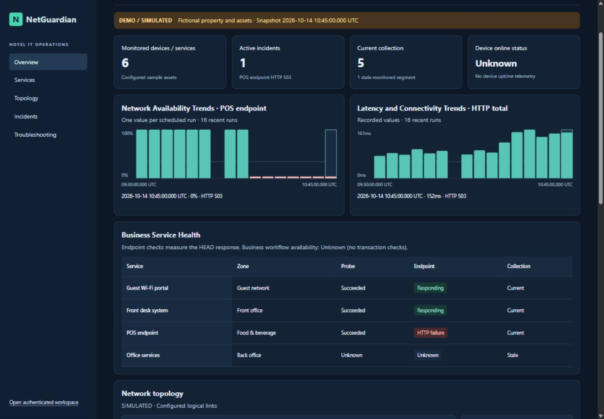
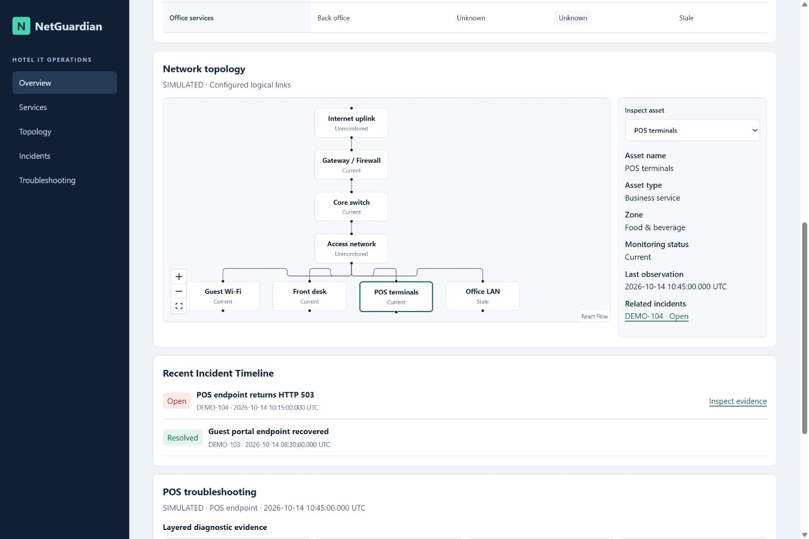
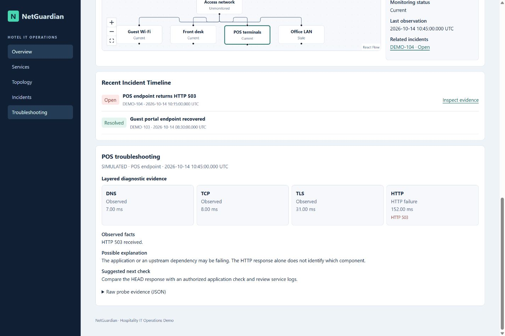
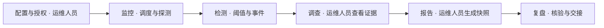
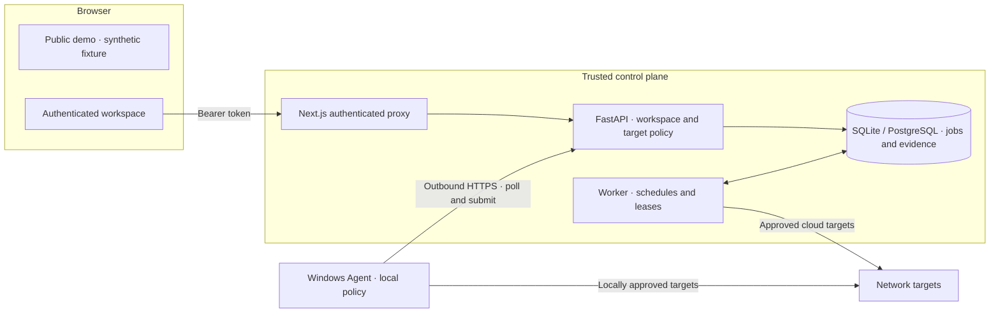

# NetGuardian — 酒店 IT 基础设施监控与网络诊断平台

[](https://github.com/TYF009/NetGuardian/actions/workflows/ci.yml) [](LICENSE)

[English](README.md) · **简体中文**
[演示快速开始](#演示快速开始) · [首次诊断演练](#首次诊断演练) · [完整本地部署](#完整本地部署) · [文档导航](docs/README.md)

NetGuardian 是我独立设计和开发的开源网络监控与证据化排障平台，面向酒店 IT 运维。平台由 FastAPI、Next.js、后台 Worker、SQLite/PostgreSQL 和 Windows Agent 组成。

- **酒店运维。** 已获运城恒泽大酒店批准，并投入酒店 IT 运维使用。
- **作品集演示。** 使用虚构酒店数据，在本地前端运行，无需 Token。
- **开源实现。** 认证工作区、任务调度、Agent 和证据处理使用 MIT 许可证。



*Aster Quay Hotel 是虚构酒店，看板数据为模拟数据。*

## 为什么开发这个项目

支持酒店 LAN/WLAN、Windows 工作站、前台系统和 POS 连接时，我发现 DNS、TCP、TLS 和 HTTP 检查分散在不同工具里，往往需要人工重复执行，结果也难以统一归档和交接。我用 NetGuardian 将授权探测、定时观测、事件记录和证据报告串在一起。项目从 Streamlit 原型逐步演进为由 FastAPI 控制面、Next.js 工作区、持久化 Worker 和出站 Windows Agent 组成的平台。

## 运城恒泽大酒店 IT 运维应用

NetGuardian 已获酒店批准并投入运维使用。我担任 IT Infrastructure & Network Engineer 期间负责 LAN/WLAN 维护、TCP/IP、DNS 和 DHCP 故障排查、Windows 技术支持、前台及 POS 连通性支持，以及 Python 自动化。生产网络数据、实际部署范围及酒店使用的具体模块不公开。设备数量、可用率、平均恢复时间（MTTR）和效率提升数据均未公开。CI 和集成测试不验证酒店生产环境的性能。公开演示与真实环境隔离，使用虚构的 Aster Quay Hotel。

## 截图

首页和本节的截图来自实际运行的演示页面，数据均为模拟。





[更多截图，包括认证工作区和证据报告](docs/product/DEMO_GUIDE.md)

## 端到端运维流程



演示中的 POS 端点返回 HTTP 503，此时探测已完成，采集依然新鲜。运维人员可以逐层查看观测和可能原因。独立的本地 HTTPS 集成场景还验证了事件生成、HTTP 204 恢复及报告快照。真实工作区自动调度探测并按阈值更新事件。目标授权、原因判断、报告生成请求和后续处置由运维人员负责。恢复记录表明观测结果发生变化，根因仍需调查。

## 核心功能

| 功能 | 实现与验证 |
| --- | --- |
| 网络诊断 | DNS、TCP、TLS 和 HTTP HEAD。ICMP、Traceroute 需显式启用，使用受限系统命令并显示能力错误。HTTP 耗时与 ICMP RTT 分开。 |
| 定时监控与事件 | 持久化调度、采集新鲜度、故障及恢复阈值、事件证据和缺测状态。Worker 与本地集成测试覆盖相关流程。 |
| Windows Agent 与对比 | 注册、出站 HTTPS、本地独立策略，以及满足兼容条件时的多位置观测对比。受控集成环境已验证。 |
| 酒店看板与拓扑 | 真实工作区趋势读取已认证 API。演示用 React Flow 展示预先配置的逻辑连接。 |
| 证据报告 | 保存不可变快照并校验 SHA-256。摘要可发现内容变动，但不认证作者身份或测量真实性。 |
| 可选 Ollama 调查 | 校验引用的已记录事实，并单独标记假设。解释能力属于实验功能，真实模型验证范围有限。 |
| 安全控制 | 默认拒绝的来源策略、DNS 与地址验证、IP 固定、工作区数据隔离及 Agent 本地策略。 |

## 架构



API 持久化任务，Worker 或已注册 Agent 异步执行。各探测位置使用版本化测量格式，数据库关联事件与源任务证据。认证工作区通过限定端点的 Next.js 代理访问 API，演示页只读取独立的模拟数据。[系统设计](docs/architecture/SYSTEM_DESIGN.md) · [数据模型](docs/architecture/DATA_MODEL.md)

## 演示快速开始

需要 Node.js 24 与 pnpm 11.25.0。在可创建项目目录的位置打开 PowerShell：

```powershell
git clone https://github.com/TYF009/NetGuardian.git
Set-Location NetGuardian
npm install -g pnpm@11.25.0
pnpm --dir web install --frozen-lockfile
pnpm --dir web build
pnpm --dir web start
```

打开[本地演示](http://127.0.0.1:3000/)，也可访问 `/demo`。演示无需 Python、数据库、Agent、后端或 Token，不发起真实网络探测。[演示指南](docs/product/DEMO_GUIDE.md)

## 完整本地部署

需要 Windows、Python 3.11、uv 0.13.7、Node.js 24 与 pnpm 11.25.0。按前述命令构建前端，再用 Ctrl+C 停止演示进程，释放端口 3000。回到仓库根目录安装 Python 依赖并完成一次性初始化。把显示的本地管理员 Token 保存到密码管理器。探测位置 ID 文件保存在 Git 忽略的本地运行目录：

```powershell
python -m pip install uv==0.13.7
uv sync --locked
$workspaceToken = (uv run --locked python -c "import secrets; print(secrets.token_urlsafe(32))").Trim()
$workspaceToken
New-Item -ItemType Directory -Path .netguardian-local -Force | Out-Null
$vantageFile = '.netguardian-local/workspace-vantage-id.txt'
if (-not (Test-Path -LiteralPath $vantageFile)) {
    [guid]::NewGuid().ToString() | Set-Content -LiteralPath $vantageFile -Encoding ascii
}
```

首次启动和以后每次打开新的 PowerShell 窗口时，加载同一个本地 Token 和已保存的 Worker 探测位置 ID。空白名单适合不发起探测的试运行。使用 `--migrate` 前请备份已有数据库：

```powershell
$workspaceToken = [pscredential]::new(
    'local', (Read-Host 'Local workspace token' -AsSecureString)
).GetNetworkCredential().Password
$env:NETGUARDIAN_TOKENS = @{ $workspaceToken = 'local' } | ConvertTo-Json -Compress
$env:NETGUARDIAN_ORIGINS = '{}'
$env:NETGUARDIAN_VANTAGE_ID = (Get-Content -LiteralPath '.netguardian-local/workspace-vantage-id.txt' -Raw).Trim()
uv run --locked python -m scripts.run_windows --migrate
```

打开[认证工作区](http://127.0.0.1:3000/workspace)并输入生成的本地 Token。重启时继续使用已保存的 ID。该 ID 只标识此 Worker 的观测位置，不授予访问权限。生产位置 ID 应与演示及测试环境分开。指定 `--migrate` 时，启动器会先执行 Alembic 迁移，再启动服务。数据库结构已是最新版本时，日常重启可省略此选项。API、Worker 和 Web 均在回环地址启动。[独立进程命令、数据库配置、Agent 注册及排障](docs/operations/LOCAL_DEVELOPMENT.md) · [运维手册](docs/operations/RUNBOOK.md)

## 首次诊断演练

### 公开演示

1. 按[演示快速开始](#演示快速开始)安装并启动前端，打开虚构的 Aster Quay Hotel 看板，确认页面有 **DEMO / SIMULATED** 标识。
2. 打开 **Services**，比较 POS 的探测结果、端点响应和采集新鲜度。模拟探测已完成，并记录到 HTTP 503。
3. 打开 **Topology**，选中 **POS terminals**，沿 **DEMO-104 · Open** 进入事件，点击 **Inspect evidence**。
4. 查看 DNS、TCP、TLS 和 HTTP 四层证据，展开 **Raw probe evidence (JSON)** 查看模拟记录。可能原因、下一步检查和已观测事实分别展示。

### 认证工作区

1. 按[完整本地部署](#完整本地部署)安装服务并生成本地管理员 Token。使用独立的本地或测试工作区，与生产数据隔离。
2. 选择你拥有或明确获准监测、且云端 Worker 的地址策略允许访问的精确 HTTPS 来源。下面是占位值，运行前请替换。先停止启动器，在启动服务的 PowerShell 窗口设置白名单。数据库结构已更新时，无需迁移即可重启。

   ```powershell
   $approvedOrigin = 'https://authorized-host.example:443'
   $env:NETGUARDIAN_ORIGINS = @{ local = @($approvedOrigin) } | ConvertTo-Json -Compress
   uv run --locked python -m scripts.run_windows
   ```

3. 打开 `/workspace`，输入本地 Token 并点击 **Connect**。在 **Diagnostics** 选择授权目标、探测类型（例如 **HTTP**）和 **Cloud worker**，点击 **Run diagnostic**。在 **Diagnostic history** 等任务结束后，点击 **Inspect** 查看记录。如果没有返回测量结果，检查 Worker 和任务状态。探测已完成也可能收到 HTTP 错误响应。
4. 在 **Monitors** 选择授权目标、探测类型和 **Cloud worker**，输入名称，设置至少 60 秒的间隔，再点击 **Create monitor**。有定时运行记录后，点击 **View history**。
5. 达到事件阈值后，可在 **Incidents** 查看事件。界面使用默认阈值：连续三次失败开启事件，连续两次成功恢复事件。已有事件时可点击 **Create evidence report**，并在 **Reports** 查看快照。健康、新建或缺少观测的监控可能没有事件可生成报告。

## 测试与验证

```sh
uv run --locked ruff check .
uv run --locked ruff format --check .
uv run --locked pytest -q
uv run --locked pytest integration/test_tls.py integration/test_dns_runtime.py integration/test_agent_workflow.py -q
pnpm --dir web test
pnpm --dir web typecheck
pnpm --dir web build
```

[GitHub Actions](https://github.com/TYF009/NetGuardian/actions/workflows/ci.yml) 覆盖 Windows、Ubuntu、PostgreSQL 集成测试、OpenAPI 漂移检查和 Web 构建。部分集成测试需单独配置可丢弃的 PostgreSQL 数据库、模型或系统凭据库。[验证记录](docs/product/VERIFICATION.md) · [浏览器验收](docs/product/BROWSER_QA.md) · [Windows 交付范围](docs/product/WINDOWS_DELIVERY.md)

CI 与测试记录描述受控环境中的行为。酒店获批使用属于独立的运维事实。当前本地交付面向 Windows，Compose 配置仍需验证后才适用于跨主机或公开部署。

## 安全与隐私

仅探测获授权的目标。控制面校验精确来源和工作区范围。云端探测拒绝私有与特殊地址，Agent 独立执行来源策略，并在支持时限制在明确允许的私网 CIDR 内。浏览器只在内存中保留 Token，Agent 使用系统凭据库。生产拓扑、地址、日志和凭据保持私有，公开演示只使用虚构数据。[威胁模型](docs/security/THREAT_MODEL.md) · [许可证与第三方资产](NOTICE.md)

## 路线图与作者

后续优先完善私有资产及区域配置、设备运行指标、监控与拓扑关联、证据分析，以及更全面的部署和运维验证。

**TYF009** · 通信工程背景 · HCIP Datacom · 酒店 IT 基础设施与技术支持 · 网络自动化。
