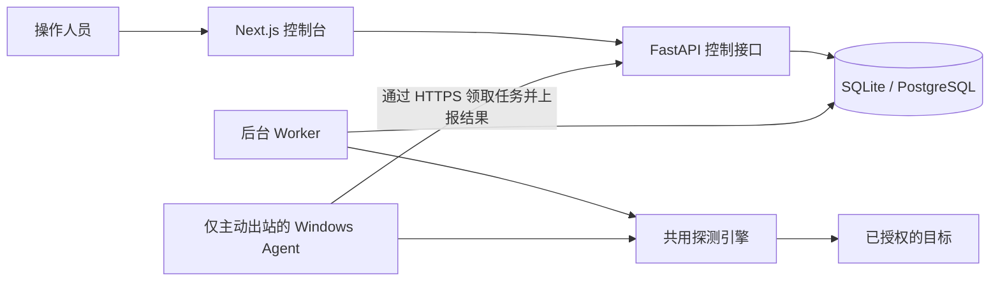

# NetGuardian · 网络诊断与循证故障排查平台

[English](README.md) · **简体中文**

NetGuardian 帮助 IT 支持人员排查服务为何无法访问。它逐层检查连接，并保留每次测量的结果，便于复盘故障和交接。

[快速开始](#快速开始) · [系统架构](#系统架构) · [演示证据](#演示证据) · [测试与验证](#测试与验证)

## 项目缘起

当一台办公电脑能访问服务而前台设备却连不上时，工单通常无法说明问题出在 DNS、TCP 连接、TLS，还是应用本身。我开发 NetGuardian，是为了让这些排查步骤可以重复执行，也让接手的人能看到判断依据。

项目从一个 Python 和 Streamlit 工具发展而来，由我独立开发，设计受到 LAN/WLAN、TCP/IP、DNS、DHCP 和 Windows 终端支持工作的启发。本文演示使用受控测试环境。

## 核心能力

| 能力 | 可以查看的内容 |
| --- | --- |
| 分层诊断 | DNS 记录、TCP 连通性、TLS 握手和证书详情，以及 HTTP HEAD 状态和耗时。可按需启用 ICMP 和 traceroute。 |
| 定时监控 | 暂停和恢复检查，查看最近采集时间、故障及恢复记录。缺少测量时，界面会显示数据缺口。 |
| 双位置对比 | 将服务端检查与已注册的 Windows Agent 检查配对，结合测量端点和时间比较记录。 |
| 事件证据 | 打开脱敏报告快照，验证 SHA-256 摘要，并追溯报告引用的原始观测。 |
| 可选辅助分析 | 配置 Ollama 后可整理报告证据。界面分别展示经过证据校验的结论和待验证的假设。 |

## 系统架构



- [Web 控制台](web/)与 [FastAPI 接口](service/api.py)负责身份验证、作业提交和工作区数据查询。
- [Worker](service/worker.py)领取有租约的后台作业并保存观测结果。[Windows Agent](agent/)通过 HTTPS 轮询任务，并独立执行本地目标策略。
- [探测引擎](probe_core/)在规定的资源和时间范围内执行检查。[Alembic 迁移](migrations/)管理数据库结构，[报告导出](service/report_files.py)校验已保存快照的完整性。

[系统设计](docs/architecture/SYSTEM_DESIGN.md) · [数据模型](docs/architecture/DATA_MODEL.md) · [威胁模型](docs/security/THREAT_MODEL.md)

## 工程实现

- **默认拒绝探测。** 服务端只允许预先批准的精确源地址。连接使用校验后的 IP，同时保留 HTTP 和 TLS 所需的主机名。HTTP 探测使用 HEAD，限制响应头大小，并禁止跟随重定向。
- **分开记录各层耗时。** DNS、TCP、TLS 和 HTTP 保留各自的时间字段。ICMP 往返时延单独记录。
- **异步执行与重试。** API 接收作业后，由 Worker 或 Agent 执行。作业使用租约与过期机制，Agent 在本地暂存结果，可重新投递已完成的观测。
- **保留故障依据。** 报告记录当时引用的观测快照，导出后可用 [离线校验脚本](scripts/verify_report.py)核验 SHA-256 摘要。

[目标策略与测量说明](docs/operations/LOCAL_DEVELOPMENT.md#target-policy-and-measurement-semantics)

## 演示证据

| 场景 | 验证记录 |
| --- | --- |
| 服务从 HTTP 503 恢复为 HTTP 204 | 受控的回环 HTTPS 服务真实返回两个状态码。本地浏览器验证了监控事件恢复及报告校验。[浏览器记录](docs/product/BROWSER_QA.md#populated-workflow-check-2026-11-05) |
| 下载事件报告 | 使用隔离测试工作区下载报告，并执行离线摘要校验。[导出验证记录](docs/product/BROWSER_QA.md#real-model-investigation-and-report-export-2026-11-06) |
| 查看缺少测量的历史记录 | 使用 101 条合成失败作业测试分页及缺失测量提示。[夹具验证记录](docs/product/BROWSER_QA.md#retained-history-production-web-build-2026-11-05) |

## 技术栈

Python 3.11 · FastAPI · SQLAlchemy · Alembic · SQLite / PostgreSQL · Next.js · React · TypeScript · Node.js 24 · pnpm · pytest · Ruff · GitHub Actions

## 快速开始

在 Windows 上安装 Python 3.11 和 Node.js 24，然后在 PowerShell 中执行：

```powershell
git clone https://github.com/TYF009/NetGuardian.git
Set-Location NetGuardian
python -m pip install uv==0.13.7
npm install -g pnpm@11.25.0
uv sync --locked
pnpm --dir web install --frozen-lockfile
pnpm --dir web build

$workspaceToken = (uv run --locked python -c "import secrets; print(secrets.token_urlsafe(32))").Trim()
$env:NETGUARDIAN_TOKENS = @{ $workspaceToken = 'local' } | ConvertTo-Json -Compress
$env:NETGUARDIAN_ORIGINS = '{}'
$env:NETGUARDIAN_VANTAGE_ID = [guid]::NewGuid().ToString()
$workspaceToken
uv run --locked python -m scripts.run_windows --migrate
```

打开[本地控制台](http://127.0.0.1:3000)，输入 PowerShell 显示的测试工作区令牌。目标白名单为空时可以浏览界面。请使用全新检出目录，或在迁移前备份现有数据库。如果要跨会话保留观测并进行比较，请保持 Worker 位置标识稳定。

[本地开发与 Agent 注册指南](docs/operations/LOCAL_DEVELOPMENT.md) · [就绪检查、备份与故障排查手册](docs/operations/RUNBOOK.md)

## 测试与验证

GitHub Actions 在 Windows 和 Ubuntu 上运行 Python 检查及选定的运行时测试，并验证 PostgreSQL 集成、Web 测试、TypeScript、OpenAPI 一致性和 Next.js 生产构建。本地 Windows 验证范围涵盖回环 TLS、Agent 作业、数据库及浏览器工作流。[CI 工作流](.github/workflows/ci.yml) · [Windows 交付记录](docs/product/WINDOWS_DELIVERY.md)

可在仓库根目录复现：

```sh
uv run --locked ruff check .
uv run --locked ruff format --check .
uv run --locked pytest -q
uv run --locked pytest integration -q -rs
pnpm --dir web test
pnpm --dir web typecheck
pnpm --dir web build
```

[集成测试所需环境](docs/operations/LOCAL_DEVELOPMENT.md#checks-and-operations)

## 当前限制

- 当前交付范围为 Windows 本地评估。Docker Compose 部署和更完整的 Linux 运行验证仍待完成。
- 回环测试覆盖了 Worker 和 Agent 工作流。跨主机部署、Agent 签名分发和持续多副本负载仍待验证。
- Ollama 辅助分析为可选实验功能，目前只验证过有限的本地场景。

[交付状态与验证边界](docs/product/DELIVERY_STATUS.md)

## 路线图

- 发布只读故障与恢复演示，注明数据来源并提供可校验报告。
- 在干净环境中验证 Compose 启动和数据库迁移，记录支持范围。
- 在独立测试主机之间验证 Agent 注册、重连和双位置测量。

## 作者与许可

我拥有通信工程背景和华为 HCIP Datacom 认证，并有 400G 光传送网络以及 IT 基础设施运维经验。NetGuardian 将这些排查经验与 Python 自动化和 Web 证据工作流结合起来。

项目代码和文档采用 [MIT 许可证](LICENSE)。第三方组件和历史素材的授权范围见 [NOTICE.md](NOTICE.md)。
